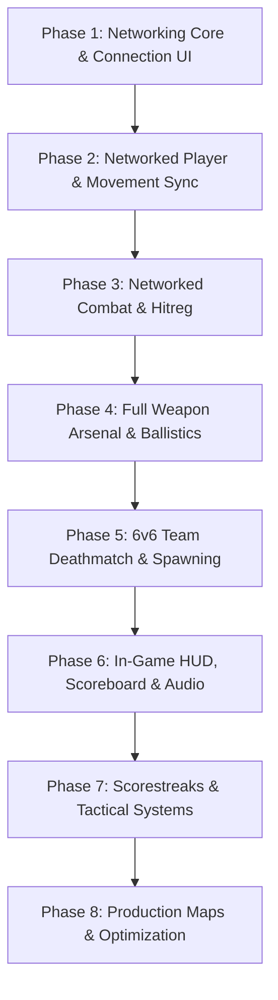

# ROADMAP.md — FPS Game Master Implementation Plan

> **ARCHITECTURE PILLAR: MULTIPLAYER-FIRST**
> Every system (player controllers, weapons, health, gamemodes, audio, VFX) must be designed from the ground up for authoritative networked multiplayer. 
> There is **no single-player offline mode converted later**. Single-player testing operates as a local listen-server (`127.0.0.1`).

---

## High-Level Execution Phases

---

## Phase 1: Networking Core, Connection UI & Host Lobby *(First Priority)*

The absolute foundation of the project. Before movement or shooting can be built, we must be able to launch a host, join as a client via IP/Port, and synchronize peer lifecycles.

### 1.1 Network Architecture
- **Protocol**: Godot `ENetMultiplayerPeer` over UDP.
- **Topology**: Listen-Server (Host + Client) with Headless Dedicated Server support.
- **Server Authority**: 
  - Server is the absolute source of truth for all game rules, player health, damage calculation, ammo counts, scores, and positions.
  - Clients send input and intents; clients never dictate damage or deaths.

### 1.2 Core Components & Deliverables
- [ ] **`NetworkManager.cs` (`src/network/core/`)**:
  - Autoload singleton managing network lifecycle.
  - Methods: `HostGame(int port, int maxPlayers)`, `JoinGame(string address, int port)`, `Disconnect()`.
  - Signal listeners: `PeerConnected`, `PeerDisconnected`, `ConnectedToServer`, `ConnectionFailed`, `ServerDisconnected`.
  - Connected peer dictionary tracking peer IDs, player names, ping, and assigned teams.
- [ ] **`ConnectionMenu.tscn` (`src/ui/menus/lobby/`)**:
  - Clean UI with input fields:
    - **Player Name**: Cached locally in user settings.
    - **Host IP Address**: Defaults to `127.0.0.1` for local testing.
    - **Port**: Defaults to `7777`.
  - Action buttons: `Host Game`, `Join Game`, `Dedicated Server (Headless)`.
  - Status display: Real-time feedback ("Connecting...", "Connected", "Connection Failed: Server full").
- [ ] **`LobbyMenu.tscn` (`src/ui/menus/lobby/`)**:
  - Connected player roster list with ping readouts.
  - Team assignment toggles (Alpha / Bravo).
  - Host "Start Match" button that initiates scene change across all peers via `Rpc`.
- [ ] **`MultiplayerSpawner` Setup (`src/network/spawning/`)**:
  - Configured to dynamically instantiate and replicate player entities into the active map when peers connect.

---

## Phase 2: Networked Player Controller & Movement Synchronization

### 2.1 Separation of Local vs. Remote Representation
- **Local Player (`LocalPlayerController.cs`)**:
  - Has active `Camera3D`, captures mouse look and input vectors (`WASD`, Jump, Crouch, Sprint, Slide).
  - Processes movement physics locally with **Client-Side Prediction** for instant, snappy response.
  - Displays First-Person Viewmodel (`ViewmodelRig.tscn`) with separate camera FOV.
- **Remote Player Proxy (`RemotePlayerProxy.cs`)**:
  - Disables local camera and input processing.
  - Displays Third-Person Worldmodel with replicated animations.
  - Receives network snapshots and performs smooth interpolation (lerping position and rotation) to eliminate visual stutter.
- **Server Player (`ServerPlayerController.cs`)**:
  - Validates player velocity and movement boundaries to prevent speedhacking or clipping.

### 2.2 Deliverables
- [ ] `Player.tscn` with authority branching (`SetMultiplayerAuthority(peerId)`).
- [ ] State Machine: `IdleState`, `MoveState`, `SprintState`, `CrouchState`, `SlideState`, `JumpState`, `FallState`.
- [ ] Snapshot replication via `MultiplayerSynchronizer` or compact custom RPC packets (`Position`, `RotationY`, `Pitch`, `StateFlags`).
- [ ] Verification in `movement_gym.tscn` with 2+ connected client instances.

---

## Phase 3: Networked Combat & Authoritative Hit Registration

### 3.1 Hit Registration Architecture
- **Client Side (Zero Perceived Latency)**:
  - When the player presses fire, client immediately plays cosmetic feedback (muzzle flash, tracer effect, local audio, camera kick).
  - Sends fire intent packet via unreliable RPC to server: `RequestFire(Vector3 origin, Vector3 direction, uint tick)`.
- **Server Side (Authoritative Verification)**:
  - Server verifies fire rate cooldown, ammunition count, and weapon validity.
  - Executes raycast query against Layer 6 (`Enemy_Hitbox`) and Layer 1 (`World_Static`).
  - Calculates damage based on hit bone multiplier:
    - **Head**: 2.5x critical
    - **Chest/Torso**: 1.0x baseline
    - **Limbs**: 0.7x reduced
  - Applies damage to target's `HealthComponent`.
- **Feedback Loop**:
  - Server invokes `RpcId(attackerId, nameof(ConfirmHit), isHeadshot, damage)` to trigger client-side crosshair hitmarkers and audio cues.
  - Server broadcasts health changes and death events.

### 3.2 Deliverables
- [ ] `HealthComponent.cs` with networked health/shield values.
- [ ] Precision hurtbox setup (`HurtboxComponent.cs`) attached to character skeleton bones.
- [ ] Authoritative kill confirmation, death state, and spectator camera.
- [ ] Cosmetic client-side ragdolls spawned on Layer 11 (`Ragdolls_Debris`).
- [ ] Respawn countdown and respawn point selection.

---

## Phase 4: Complete Weapon Arsenal & Ballistics System

All weapons are data-driven using C# `[GlobalClass]` resources (`WeaponData.cs`).

### 4.1 Weapon Classes
1. **Assault Rifles (AR)**: Full-auto, balanced recoil, medium-to-long range dropoff (e.g. 600-750 RPM).
2. **Submachine Guns (SMG)**: High fire rate (800-1000 RPM), low recoil, high hip-fire spread recovery, steep damage falloff.
3. **Light Machine Guns (LMG)**: Large magazine capacity (75-100 rounds), heavy recoil, slow ADS time and movement penalty.
4. **Shotguns**: Multi-pellet spread (8-12 rays per shot), pump-action and semi-auto, devastating close-quarters damage.
5. **Designated Marksman Rifles (DMR)**: High-damage semi-auto, low rate of fire, reward accurate rapid tapping.
6. **Sniper Rifles**: One-shot upper-torso/head potential, bolt-action cycle time, scoped overlay with sway and breath-holding (`Shift`).
7. **Pistols / Sidearms**: Quick draw swap speed, emergency backup weapons.
8. **Launchers**: High-explosive rockets using ballistic projectile physics, detonating on impact with radius splash damage (Layer 13 `Area_Damage`).
9. **Melee (Knife)**: Instant close-quarters slash with short forward hit detection cone.

### 4.2 Weapon Subsystems
- [ ] **Procedural Recoil**: `SpringInterpolator.cs` driving rotational pitch/yaw bounce and translational kick.
- [ ] **Aim Down Sights (ADS)**: Smooth camera FOV transition and viewmodel alignment to iron sights / optic red dots.
- [ ] **Weapon Sway & Bobbing**: Procedural inertia reacting to mouse look speed and movement velocity.
- [ ] **Reloading State Machine**: Distinguish tactical reloads (ammo remaining) from empty chamber reloads.

---

## Phase 5: 6v6 Team Deathmatch & Match Lifecycle

### 5.1 Team & Spawning Infrastructure
- **Teams**:
  - `Team Alpha` (Blue) vs `Team Bravo` (Red) — 6v6 (12 players total).
  - Friendly fire disabled: Server rejects damage between matching team IDs.
- **Dynamic Spawn Algorithm**:
  - Avoids spawning players within direct enemy line-of-sight or inside active combat radii.
  - Dynamically flips spawn zones when one team pushes deep into enemy territory.

### 5.2 Match Lifecycle Rules
- **Game Mode**: Team Deathmatch (`TeamDeathmatchMode.cs`).
  - Score limit: First team to reach **75 kills** (or team with highest kills when time expires).
  - Time limit: **10 minutes**.
- **Lifecycle States**:
  1. `WaitingForPlayers`: Minimum players required to start countdown.
  2. `MatchWarmup`: 10-second countdown; players locked in spawn points.
  3. `MatchInProgress`: Active scoring, respawning, and combat.
  4. `MatchEnded`: Game freezes; announces winning team ("Team Alpha Victory").
  5. `PostMatchIntermission`: Final scoreboard display before cycling map or returning to lobby.

---

## Phase 6: In-Game UI, Scoreboard, HUD & Audio

### 6.1 User Interface Deliverables
- [ ] **HUD (`src/ui/hud/`)**:
  - Dynamic Crosshair: Expands with movement velocity and continuous fire spread.
  - Hitmarkers: Standard white tick for body hit, red tick for headshot, skull icon for kill.
  - Health & Shield status bar with directional damage indicator arrows.
  - Weapon Status: Current ammo in magazine, reserve ammo count, fire mode (Auto/Semi/Burst).
  - Kill Feed: Real-time kill notifications in top-right corner (`[Attacker] [WeaponIcon] [Victim]`).
  - Match Header: Round timer countdown and Team Alpha vs Bravo score comparison.
- [ ] **Scoreboard (`src/ui/hud/scoreboard/`)**:
  - Held with `Tab` key.
  - Two-column team layout showing: Player Name, Ping (ms), Kills, Deaths, Assists, Score, Killstreak count.

### 6.2 Audio Architecture
- [ ] Dedicated audio bus layout: `Master`, `Music`, `SFX`, `Weapons`, `Footsteps`, `UI`, `Voices`.
- [ ] Surface acoustic detection: Raycast queries `PhysicsSurfaceData.tres` on impact to play wood, metal, concrete, or flesh footstep and bullet impacts.
- [ ] 3D spatial attenuation curve configured for gunshots audible across the entire map.

---

## Phase 7: Scorestreaks & Tactical Systems

Authoritative streak tracking awarded for uninterrupted score and kill milestones:

1. **UAV / Recon Radar (3 Kills / 375 Score)**:
   - Emits a periodic radar sweep every 3 seconds for 30 seconds, pinging enemy positions on team minimaps.
2. **Care Package (4 Kills / 500 Score)**:
   - Thrown beacon marker that calls in a physical crate dropped from the sky containing a randomized higher-tier streak or power weapon.
3. **Sentry Turret (6 Kills / 750 Score)**:
   - Deployable automated turret with 180-degree targeting cone, tracking and firing upon enemies in line-of-sight.
4. **Precision Mortar / Airstrike (8 Kills / 1,000 Score)**:
   - Tablet interface allowing the player to designate 3 bombardment points on the tactical map, triggering explosive artillery barrages.

---

## Phase 8: Production Maps & Optimization Verification

### 8.1 Level Design
- [ ] **Map 1: `Warehouse` / `Outpost` (Production 6v6 Arena)**:
  - Classic 3-lane FPS layout with balanced flanking routes, verticality, chokepoints, and clean sightlines.
  - Modular structural assets with baked occlusion culling (`OccluderInstance3D`).
- [ ] **Test Gyms (`src/levels/world_gym/`)**:
  - `movement_gym.tscn`: Ramps, 45-degree stairs, ladders, jump gaps.
  - `ballistics_gym.tscn`: Target range with damage indicators and bullet spread walls at 10m, 25m, 50m.
  - `benchmark_stress.tscn`: Stress tests 12 synchronized network players firing automatic weapons continuously.

### 8.2 Optimization Sign-Off
- [ ] Profiler confirms **zero GC allocations** during active firefights.
- [ ] Stable 144+ FPS in Forward+ renderer with direct D3D12 on target hardware.
- [ ] Draw calls kept under 500 per frame using `MultiMeshInstance3D` batching and distance culling.
